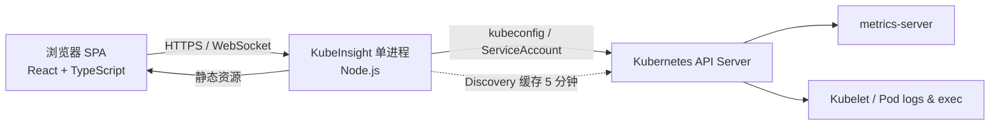

# KubeInsight

> 轻量、自托管的 Kubernetes 控制台：**一个进程、一个端口、无数据库、无 Agent、无 CRD**。

KubeInsight 面向需要「打开浏览器就能看清并处理集群」的团队：把 Overview、资源列表、事件、YAML 编辑、日志流、容器终端和 metrics 收在一个紧凑的界面里，同时不引入 Rancher / KubeSphere 这类平台级依赖。

- 单个 Node.js 进程同时提供 SPA 与 API
- 直接使用本机 kubeconfig 或 Pod 内 ServiceAccount，不落库、不缓存集群数据
- 默认脱敏 Secret；支持只读模式、共享令牌认证与 RBAC 感知
- 通过 API Discovery 自动支持 CRD / 聚合 API，而不是只为内置资源写死页面
- 适配浅色/深色主题与移动端

---

## 目录

- [为什么再造一个 K8s 控制台](#为什么再造一个-k8s-控制台)
- [功能](#功能)
- [快速开始](#快速开始)
- [部署到集群](#部署到集群)
- [配置](#配置)
- [安全模型](#安全模型)
- [架构](#架构)
- [项目结构](#项目结构)
- [开发与测试](#开发与测试)
- [已知限制](#已知限制)
- [License](#license)

---

## 为什么再造一个 K8s 控制台

同类工具并不少，但各自解决的是不同问题。详细对比见 [docs/design.md](docs/design.md)。

| 工具 | 形态 | 主要定位 | 与 KubeInsight 的差异 |
| --- | --- | --- | --- |
| Kubernetes Dashboard | In-cluster Web | 官方经典面板（**2026-01 已归档**） | 无原生多集群；KubeInsight 仍是活跃的单进程实现 |
| Headlamp | In-cluster / 桌面 | SIG UI 推荐的插件化 UI | 功能更全，但插件运行时与前端依赖更重 |
| k9s | 终端 TUI | 键盘驱动的极速运维 | 没有浏览器/团队共享界面 |
| Lens / Freelens | Electron 桌面 | 个人 K8s IDE | 数百 MB 客户端，不适合作为团队入口 |
| Rancher / KubeSphere | 平台 | 集群生命周期与多租户治理 | 多服务、数据库、较重，超出「看集群」需求 |
| KubePi / k8m | Web 面板 | 国内生态的图形化面板 | 通常带数据库或 AI/多租户能力，体量更大 |
| **KubeInsight** | **单 Node 进程 + SPA** | **团队浏览器入口 + 日常排障闭环** | **零数据库、零 CRD、零 Agent；镜像约百 MB 级** |

KubeInsight 的目标不是替代 Rancher 做集群交付，也不是替代 k9s 做纯键盘运维，而是填补「**一个轻量、可直接连现有 kubeconfig、打开就能用**」的空白。

## 功能

**观察**

- 集群概览：节点健康、Pod 阶段分布、CPU/内存压力（metrics-server）、工作负载就绪度、异常 Pod、最近告警
- 资源列表：Pods / Deployments / StatefulSets / DaemonSets / ReplicaSets / Jobs / CronJobs / Services / Ingresses / EndpointSlices / ConfigMaps / Secrets / HPA / ResourceQuota / LimitRange / PDB / PVC / PV / StorageClass / Nodes / Namespaces / CRD / RBAC 对象
- 事件中心：按类型、对象、关键字筛选，点击直达关联资源
- 全局搜索：`⌘K` / `Ctrl K` 跨命名空间搜索资源
- 节点视图：容量、可分配、实时使用率、污点、条件、该节点上的 Pod

**检查**

- 任意资源的完整 YAML（Secret 默认脱敏）
- Pod 日志流：容器切换、实时跟随、时间戳、上一个容器、关键字过滤、下载
- 容器终端：基于 Kubernetes exec，支持 `sh/bash/ash/zsh` 与窗口尺寸同步
- API Explorer：浏览 Discovery 返回的全部 API 资源与 CRD，查看实例

**操作**

- 创建 / 编辑 YAML，多文档、Server-Side Apply、冲突强制覆盖
- 扩缩容、滚动重启、节点封锁/恢复调度、删除（可选级联策略）
- 操作前依据 SelfSubjectRulesReview 做按钮级权限收敛；服务端仍以 Kubernetes RBAC 为最终边界

**运行方式**

- 多 kubeconfig context 切换
- 可选的共享令牌登录（HttpOnly Cookie）
- `KUBEINSIGHT_READ_ONLY=1` 全站只读（同时禁用终端）
- 自动刷新（关闭 / 5s / 10s / 30s）
- 深色/浅色主题，移动端表格自动转卡片

## 快速开始

要求：**Node.js ≥ 22.18**，以及一个可用的 kubeconfig（默认 `~/.kube/config`）。

```bash
npm install

# 开发模式：API 8090 + Vite 5173（自动代理 /api 与 WebSocket）
npm run dev
# 打开 http://localhost:5173
```

生产模式（单端口）：

```bash
npm run build
npm start
# 打开 http://127.0.0.1:8090
```

也可以直接用 Docker：

```bash
docker build -t kubeinsight:0.1.0 .

docker run --rm -p 8090:8090 \
  -e KUBEINSIGHT_AUTH_TOKEN='change-me' \
  -v "$HOME/.kube:/home/node/.kube:ro" \
  kubeinsight:0.1.0
```

> Linux 上宿主机 UID 不是 1000 时，kubeconfig 可能因为 600 权限无法读取；可追加 `--user "$(id -u):$(id -g)"`（容器内仍以非 root 运行）。

> 默认只监听 `127.0.0.1`。容器中会通过 `HOST=0.0.0.0` 暴露端口；如果要对局域网开放，**务必同时设置访问令牌或放在带认证的反向代理之后**。

如果启动时没有找到 kubeconfig，页面会显示配置引导，而不是直接报错退出。

## 部署到集群

```bash
kubectl apply -f deploy/kubernetes.yaml

# 读取示例令牌（生产环境请替换 Secret）
kubectl -n kubeinsight get secret kubeinsight-auth -o jsonpath='{.data.token}' | base64 -d; echo

kubectl -n kubeinsight port-forward svc/kubeinsight 8090:8090
# 打开 http://127.0.0.1:8090
```

清单包含 Namespace、ServiceAccount、ClusterRole/Binding、Deployment、Service 与示例 Secret，使用非 root、只读根文件系统与 healthz 探针。RBAC 说明见 [deploy/README.md](deploy/README.md)。

## 配置

| 参数 / 环境变量 | 默认值 | 说明 |
| --- | --- | --- |
| `--host` / `KUBEINSIGHT_HOST` | `127.0.0.1` | 监听地址；容器内用 `0.0.0.0` |
| `--port` / `KUBEINSIGHT_PORT` | `8090` | HTTP 端口 |
| `--kubeconfig` / `KUBEINSIGHT_KUBECONFIG` / `KUBECONFIG` | `~/.kube/config` | kubeconfig 文件或路径列表 |
| `--context` / `KUBEINSIGHT_CONTEXT` | current-context | 默认 context |
| `KUBEINSIGHT_AUTH_TOKEN` | 未设置 | 设置后启用共享令牌登录 |
| `KUBEINSIGHT_READ_ONLY=1` / `--read-only` | `false` | 禁止写操作与容器终端 |
| `KUBEINSIGHT_DISABLE_EXEC=1` / `--no-exec` | `false` | 仅禁用容器终端 |
| `KUBEINSIGHT_WEB_DIR` | `dist/public` | 前端构建产物目录 |
| `KUBEINSIGHT_LOG_LEVEL` | `info` | `debug` / `info` / `warn` / `error` |

CLI 帮助：

```bash
npm start -- --help
```

## 安全模型

KubeInsight 是**运维入口**，不是零信任控制平面。请把下面几条当作硬约束：

1. **共享令牌不是用户体系。** 设置 `KUBEINSIGHT_AUTH_TOKEN` 后，所有能够登录的人共享服务端 kubeconfig 的权限；API Server 审计日志中的操作者也始终是服务端凭证身份。需要按人授权时，请使用 Headlamp/OIDC 方案，或为不同团队运行不同实例/不同 ServiceAccount。
2. **不要直接暴露在公网。** 默认只绑定 `127.0.0.1`；对外时必须使用 HTTPS 反向代理，并叠加认证、IP 白名单或 VPN。
3. **Secret 默认脱敏。** 列表与详情不返回 `data`；点击“显示明文”才会通过受 RBAC 约束的 GET 取回并发送到浏览器。请按最小权限授予 `secrets get`。
4. **终端是高风险能力。** Pod exec 可修改容器内文件、读取进程内存。只读模式或 `--no-exec` 会禁用终端；生产环境建议结合 RBAC 限制 `pods/exec`。
5. **RBAC 由集群裁决。** UI 的权限提示基于 SelfSubjectRulesReview，仅用于减少误点；服务端不会绕过 Kubernetes 鉴权。

## 架构



- **认证**：客户端证书、Bearer Token、Token 文件、Basic Auth、client-go 风格的 `exec` 凭证插件（EKS/GKE/AKS 等）
- **TLS**：支持 CA、`insecure-skip-tls-verify`、`tls-server-name`、API Server 路径前缀
- **资源访问**：基于 Discovery 的通用 REST 客户端，不依赖 CRD 安装或代码生成
- **流式能力**：日志用 HTTP chunked 透传；exec 使用 `v4.channel.k8s.io` WebSocket 协议
- **缓存**：仅内存中的 Discovery（5 分钟）与版本信息（60 秒），不持久化任何资源或凭证

## 项目结构

```text
server/src/
  kubeconfig.ts          多文件 kubeconfig、context、凭证解析
  state.ts               进程级 client / discovery / version 缓存
  server.ts              HTTP、鉴权、静态资源、WebSocket 升级
  k8s/
    client.ts            Kubernetes REST 客户端（TLS / 超时 / 重试）
    auth.ts              证书、token、exec 插件凭证
    discovery.ts         API Discovery 与资源查找
    metrics.ts           metrics.k8s.io 聚合
    sanitize.ts          managedFields 清理、Secret 脱敏、YAML 生成
    urls.ts              GVR -> URL 与输入校验
  api/                   meta / overview / resources / actions / events / logs / exec / search / access
web/src/
  pages/                 概览、资源列表、事件、API Explorer、设置
  components/            数据表、详情抽屉、YAML 编辑器、日志、终端、命令面板
  catalog.tsx            导航与各资源列定义
  AppContext.tsx         集群、命名空间、权限、刷新、主题
deploy/kubernetes.yaml   集群内部署清单
docs/design.md           工具对比与设计取舍
docs/api.md              HTTP API 参考
tests/                   单元测试（Vitest）
```

## 开发与测试

```bash
npm run typecheck   # 服务端 + 前端 TypeScript 检查
npm test            # Vitest 单元测试
npm run build       # 生成 dist/server 与 dist/public
npm run smoke       # 需先启动服务；对真实集群做只读冒烟
```

开发时前后端分离：Vite 在 5173 提供 HMR，并把 `/api` 与 `/api/exec` 代理到 `127.0.0.1:8090`。

## 已知限制

- **无内置用户体系 / SSO**：只有可选共享令牌；多租户、按人审计不在当前范围。
- **轮询而非 watch**：列表与概览按刷新间隔重新拉取，超大集群建议关闭自动刷新；日志与终端是真正的流式连接。
- **不管理集群生命周期**：不创建/升级集群，不内置 Helm、GitOps、流水线、告警。
- **单实例**：无数据库，因此不支持多副本共享状态；Discovery 缓存按实例独立。
- **exec 协议要求 Kubernetes ≥ 1.21**（WebSocket v4 channel）；极老集群或仅支持 SPDY 的代理可能不可用。
- **metrics 依赖 metrics-server**；不可用时自动隐藏实时使用率并提示。
- **不做写操作 dry-run UI**：`/api/apply` 支持 `dryRun` 参数，但界面未暴露。

## License

Apache-2.0。见 [LICENSE](LICENSE)。
