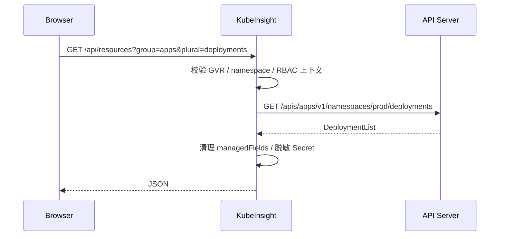

# 设计说明：为什么是 KubeInsight

> 记录时间：2026-10-26。工具数据来自 GitHub API 与公开文档，star 数会随时间变化，仅用于判断生态位置。

## 1. 问题边界

要做的不是「又一个 Kubernetes 平台」，而是一个**团队共用的浏览器入口**，满足三件事：

1. 连接已有 kubeconfig，不要求先在集群里安装 CRD、Agent 或数据库；
2. 覆盖日常排障闭环：**看状态 → 查事件 → 读日志 → 进容器 → 改 YAML**；
3. 单进程、低资源、易部署，能放在跳板机、边缘节点或小集群里。

非目标：集群生命周期管理、GitOps、CI/CD、多租户 SaaS、告警平台、服务网格控制面。

## 2. 现有工具对比

| 工具 | 形态 | 体量 / 依赖 | 多集群 | 写操作 / 终端 | 扩展方式 | 主要短板 |
| --- | --- | --- | --- | --- | --- | --- |
| **Kubernetes Dashboard** | In-cluster Web | Go + Angular，需部署 | 无原生多集群 | 部分 | 无插件市场 | 原仓库 2026-01 归档；导航与交互偏旧 |
| **Headlamp** | In-cluster Web / 桌面 | TypeScript + 插件运行时 | 插件/多实例 | 支持 | 前端插件 | 功能全面但依赖较多；团队化仍需额外认证方案 |
| **k9s** | 终端 TUI | 单个 Go 二进制 | 支持 | 支持 | 皮肤/插件 | 无浏览器界面，难以作为团队共享入口 |
| **Lens / Freelens** | Electron 桌面 | 数百 MB 客户端 | 支持 | 支持 | 扩展 | 个人 IDE 形态；不适合集中访问与审计 |
| **Rancher** | 多集群平台 | 多服务 + 数据库 | 强 | 支持 | 生态完整 | 面向集群交付与治理，明显超出单集群排障 |
| **KubeSphere** | 平台 | 多服务 + 数据库 | 强 | 支持 | 平台插件 | 体量大，概念多，学习成本高 |
| **KubePi** | Web 面板 | Go + 数据库 | 支持 | 支持 | 有限 | 更偏面板式管理，独立部署组件较多 |
| **k8m** | 单文件 Dashboard | Go 单二进制 + AI | 支持 | 支持 | AI / MCP | 以 AI 能力为卖点，功能面更大 |
| **Kite** | 轻量 Web | TypeScript | 支持 | 支持 | 有限 | 与 KubeInsight 定位最接近，偏「多集群工作区」 |
| **KubeInsight** | 单 Node 进程 + SPA | 无数据库 / 无 CRD / 无 Agent | kubeconfig contexts | 支持（日志/exec/YAML） | Discovery 通用资源 | 无内置 SSO；轮询而非 watch |

### 数据快照（2026-10-26，GitHub）

| 项目 | Stars | 语言 | License | 状态 |
| --- | ---: | --- | --- | --- |
| kubernetes/dashboard（已迁移至 kubernetes-retired） | 15.4k | Go | Apache-2.0 | archived |
| Headlamp | 7.5k | TypeScript | Apache-2.0 | active |
| k9s | 34.9k | Go | Apache-2.0 | active |
| Freelens | 5.7k | TypeScript | MIT | active |
| Rancher | 26.0k | Go | Apache-2.0 | active |
| KubeSphere | 17.1k | Go | — | active |
| KubePi | 3.0k | Go | — | active |
| k8m | 889 | Go | MIT | active |
| Kite | 3.2k | TypeScript | Apache-2.0 | active |
| Devtron | 5.6k | Go | Apache-2.0 | active |

结论：**通用大盘已经很拥挤，但「单进程、无数据库、直接连 kubeconfig、团队浏览器可用」这一格仍然成立**。KubeInsight 选择在这一格里做到足够完整，而不是继续堆平台能力。

## 3. 关键取舍

### 3.1 为什么用 Node.js 而不是 Go

- 前后端同一套 TypeScript 类型与工具链，构建链更短：`tsc` + `vite`，没有代码生成。
- Kubernetes 客户端手写为轻量 REST + TLS + exec 凭证，避免引入完整 client-go 式依赖图。
- 代价是运行内存高于 Go 单二进制；因此把镜像控制在 `node:24-alpine` + 两个生产依赖（`ws`、`yaml`），并关闭任何常驻后台任务。
- 生产镜像约百 MB 级，常驻内存取决于列表规模；对跳板机/小集群足够，但不适合与 Go 二进制比「绝对最小」。

### 3.2 为什么没有数据库

所有展示数据都来自 API Server 的实时查询；进程内只缓存：

- Discovery 资源表（5 分钟）；
- API Server 版本（60 秒）；
- 凭证（token 文件 60 秒、exec 插件按过期时间）。

因此没有迁移、备份、GC，也不会出现「面板里的数据与集群不一致」。代价是列表响应无法做服务端分页缓存，超大集群需要调低刷新频率。

### 3.3 为什么用 Discovery 而不是为每个资源写页面

`/api`, `/apis` 的 Discovery 结果被归一化为 `{group, version, plural, kind, namespaced, verbs}`。UI 的固定目录只负责「常用资源的列定义与排版」，API Explorer 与 CRD 实例浏览则直接走通用 GVR。这样：

- 新增 CRD 不需要改后端；
- 删除/隐藏内置资源也不会让导航崩掉；
- 列表、详情、YAML、删除共用一条代码路径。

### 3.4 为什么轮询而不是 watch

watch 需要处理 resourceVersion 失效、410 Gone、重连与背压，且每个打开的标签页都会占用一条长连接。KubeInsight 选择：

- 列表/概览：按 5/10/30 秒轮询，手动刷新即时生效；
- 日志与终端：真正的流式连接，按需建立。

这让「打开十个标签页」不会变成十个 watch 流；代价是数据最多滞后一个刷新周期。

### 3.5 为什么 Secret 默认脱敏

Secret 的 `data` 一旦进入浏览器内存，就可能被 DevTools、截图、前端缓存带走。默认只返回 key 名；点击“显示明文”才发起带 RBAC 约束的 GET。即使如此，浏览器仍会短暂持有明文，这一点在文档中明确说明。

### 3.6 exec 的实现

Kubernetes 1.21+ 支持 `v4.channel.k8s.io` WebSocket 子协议。桥接层负责：

- 浏览器 JSON 文本帧 ↔ 二进制 channel 帧；
- channel 0 输入、1 stdout、2 stderr、3 错误、4 resize；
- 认证头由服务端注入，浏览器永远拿不到 kubeconfig 凭证；
- 服务端可全局禁用（`--no-exec` / 只读模式）。

注意：exec 端点**不接受 `Accept` 头**，带 `application/json` 会被 API Server 以 406 拒绝；这是实现时踩到的一个真实坑（已写入代码注释）。

## 4. 请求链路

- 所有请求都带 `cluster`（context id），后端按 context 选择 client 与 Discovery。
- 写操作先经过 `requireWritable`（只读模式），再由 API Server RBAC 做最终裁决。
- 错误统一映射为 `{error:{message,code,status}}`，保留 Kubernetes 的 `reason`。

## 5. 轻量预算

| 项目 | 目标 | 实测/说明 |
| --- | --- | --- |
| 进程数 | 1 | Node HTTP server |
| 数据库 | 0 | 无 |
| CRD / Agent | 0 | 无 |
| 生产依赖 | 2 | `ws`（exec）、`yaml`（kubeconfig/YAML） |
| 镜像 | 百 MB 级 | `node:24-alpine` + 生产依赖 + 静态资源 |
| 常驻内存 | 80–120 MB | 空载约 78 MB（Windows / Node 24）；随列表与终端连接变化 |
| 启动 | < 1s | 无迁移、无预热 |
| Discovery 首次 | 约 0.3–1s | 24 个 API 组、78 个资源（测试集群），之后 5 分钟缓存 |
| 概览请求 | 7 个并发 list | 节点、命名空间、Pod、Deployment、StatefulSet、DaemonSet、事件 + metrics |
| 搜索 | 13 类并发 list，上限 500 | 测试集群约 1.5s；按需触发 |

## 6. 威胁模型

**资产**：kubeconfig 凭证（可能等价于 cluster-admin）、Secret 明文、写操作能力、exec 终端。

**信任边界**：

- 浏览器 → KubeInsight：共享令牌 + HttpOnly Cookie；同源校验；CSP 禁止外部脚本。
- KubeInsight → API Server：TLS 校验、凭证仅驻留服务端内存。
- 集群 RBAC：最终授权边界。

**主要风险与控制**：

| 风险 | 控制 |
| --- | --- |
| 面板被公网访问 | 默认绑定 127.0.0.1；文档要求 HTTPS 反代 + 额外认证 |
| XSS 窃取凭证 | 凭证不下发；CSP；React 默认转义；YAML/日志按文本渲染 |
| CSRF 触发写操作 | SameSite=Strict Cookie；写请求校验 Origin/Host |
| Secret 泄漏 | 列表/详情默认脱敏；显式 reveal |
| 共享凭据无按人审计 | 文档明确限制；建议按团队拆分实例/ServiceAccount |
| exec 横向移动 | 可全局禁用；只读模式禁用；依赖 RBAC `pods/exec` |

## 7. 与 Headlamp / Kite 的差异

- 相比 Headlamp：不追求插件生态与全量功能，换取更少的运行时依赖和更直接的部署；没有桌面版。
- 相比 Kite：更强调「排障闭环」（日志流、exec、事件、YAML 编辑）与单团队自托管；多集群仅通过 kubeconfig context，不做工作区编排。
- 相比 k8m：不做 AI/Agent 集成，也不引入模型依赖；保持可审计的确定性行为。

## 8. 后续路线

优先级从高到低：

1. **watch/SSE**：在资源列表上做增量更新，降低轮询开销。
2. **OIDC / impersonation**：按用户身份访问 API Server，实现真正的按人审计。
3. **Helm release 浏览**：只读查看 release 与 values，不做部署编排。
4. **Prometheus 查询**：可选的指标面板，避免把时序库塞进主进程。
5. **审计与操作记录**：记录谁在 UI 上发起了什么写操作（需要用户体系）。
6. **e2e 测试**：用 kind 起临时集群，覆盖 apply / logs / exec。

## 9. 参考

- Kubernetes Dashboard 归档仓库：<https://github.com/kubernetes-retired/dashboard>
- Headlamp：<https://github.com/headlamp-k8s/headlamp>
- k9s：<https://github.com/derailed/k9s>
- Kubernetes WebSocket exec 协议：<https://github.com/kubernetes/kubernetes/blob/master/staging/src/k8s.io/apimachinery/pkg/util/httpstream/wsstream/>
- SelfSubjectRulesReview：<https://kubernetes.io/docs/reference/kubernetes-api/authorization-resources/self-subject-rules-review-v1/>
